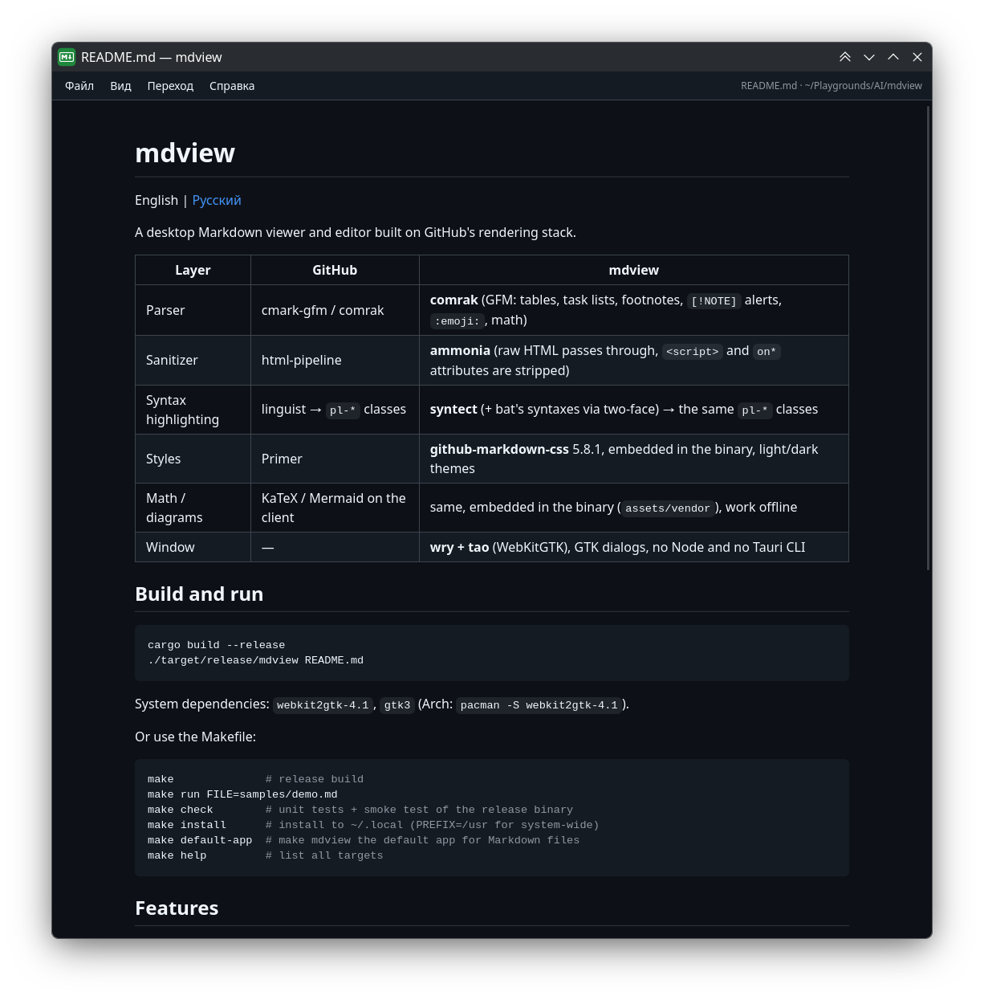

# mdview

[English](README.md) | Русский

Десктопный просмотрщик и редактор Markdown, собранный по стеку GitHub.



| Слой | GitHub | mdview |
|------|--------|--------|
| Парсер | cmark-gfm / comrak | **comrak** (GFM: таблицы, чекбоксы, сноски, алерты `[!NOTE]`, `:emoji:`, математика) |
| Санитайзер | html-pipeline | **ammonia** (raw HTML проходит, `<script>`/`on*` вырезаются) |
| Подсветка кода | linguist → классы `pl-*` | **syntect** (+ синтаксисы bat через two-face) → те же классы `pl-*` |
| Стили | Primer | **github-markdown-css** 5.8.1, вшит в бинарник, темы light/dark |
| Формулы / диаграммы | KaTeX / Mermaid на клиенте | то же, вшиты в бинарник (`assets/vendor`), работают офлайн |
| Окно | — | **wry + tao** (WebKitGTK), диалоги GTK, без Node и без Tauri CLI |

## Сборка и запуск

```sh
cargo build --release
./target/release/mdview README.md
```

Системные зависимости: `webkit2gtk-4.1`, `gtk3` (Arch: `pacman -S webkit2gtk-4.1`).

Либо через Makefile:

```sh
make              # release-сборка
make run FILE=samples/demo.md
make check        # юнит-тесты + smoke-тест release-бинарника
make install      # установка в ~/.local (PREFIX=/usr для системной)
make default-app  # сделать mdview приложением по умолчанию для Markdown
make help         # список всех целей
```

## Возможности

- Меню «Файл / Вид / Переход / Справка», прячется и показывается по `Ctrl+Shift+M` (по умолчанию открыто).
- Открыть (`Ctrl+O`), новый (`Ctrl+N`), сохранить (`Ctrl+S`), сохранить как (`Ctrl+Shift+S`), недавние файлы, закрыть (`Ctrl+W`), выход (`Ctrl+Q`).
- Режимы: просмотр, редактор + просмотр, редактор (`Ctrl+E` переключает по кругу). Превью перерисовывается при наборе.
- Редактор: `Tab`/`Shift+Tab` отступы, `Enter` продолжает списки, `Ctrl+B`/`Ctrl+I`/`` Ctrl+` `` обёртки, `Ctrl+K` ссылка, строка состояния.
- Тема: как в системе / светлая / тёмная (`Ctrl+Shift+T`), масштаб `Ctrl+=`/`Ctrl+-`/`Ctrl+0`.
- Относительные ссылки на `.md` открываются в том же окне, история «назад/вперёд» (`Alt+←`/`Alt+→`, боковые кнопки мыши), внешние ссылки уходят в браузер, папки — в файловый менеджер.
- Слежение за файлом: внешние правки перечитываются сами; если в редакторе есть несохранённое, показывается баннер с выбором. Ручная перезагрузка по `Ctrl+R` или `F5`.
- Перетаскивание файла в окно. Относительные картинки/видео отдаются через собственный протокол `mdview://`.
- Настройки (тема, режим, меню, масштаб, недавние, размер окна) хранятся в `~/.config/mdview/config.json`.

## Служебные флаги

- `mdview --dump file.md` печатает готовый HTML-фрагмент в stdout.
- `mdview --syntaxes` печатает список языков подсветки.
- `MDVIEW_WINDOW_SIZE=1200x900` задаёт размер окна.
- `MDVIEW_DEBUG_SCRIPT=test.js` выполняет скрипт в странице после каждой загрузки (для автотестов под Xvfb).

## Структура

```
src/main.rs     окно, протокол mdview://, IPC-команды, диалоги GTK, конфиг, watcher
src/render.rs   comrak → подсветка в классы pl-* → ammonia; сборка CSS тем
assets/         github-markdown.css, index.html (оболочка), app.css, app.js
assets/vendor/  KaTeX и Mermaid (версии в VERSIONS), встраиваются через src/vendor.rs
samples/        demo.md со всеми фичами
```
