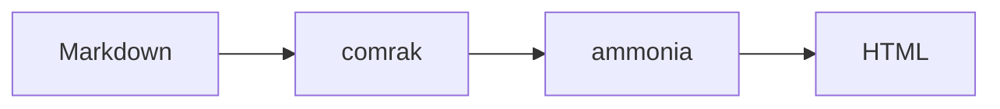

# mdview demo

Текст с **жирным**, *курсивом*, ~~зачёркнутым~~, `inline code` и автоссылкой https://github.com/github/cmark-gfm. Эмодзи :rocket: :tada:

> [!NOTE]
> Это GitHub-алерт. Поддерживаются NOTE, TIP, IMPORTANT, WARNING, CAUTION.

> [!WARNING]
> Осторожно, горячо.

## Таблица

| Компонент | Роль | Язык |
|:----------|:----:|-----:|
| comrak | парсер GFM | Rust |
| ammonia | санитайзер | Rust |
| syntect | подсветка | Rust |

## Задачи

- [x] парсер
- [x] подсветка
- [x] KaTeX и Mermaid офлайн (вшиты в бинарник)

## Код

```rust
fn main() {
    let x: Vec<u32> = (1..=10).filter(|n| n % 2 == 0).collect();
    println!("{:?}", x); // even numbers
}
```

```python
def fib(n: int) -> int:
    return n if n < 2 else fib(n - 1) + fib(n - 2)
```

## Математика

Inline: $E = mc^2$, display:

$$
\int_0^\infty e^{-x^2}\,dx = \frac{\sqrt{\pi}}{2}
$$

## Mermaid



## Картинка и сноска

 ссылка на [другой файл](other.md) и сноска[^1].

<details><summary>Raw HTML details</summary>

Внутри работает **markdown**. А вот скрипт вырезается: <script>alert(1)</script> 

</details>

[^1]: Текст сноски.
